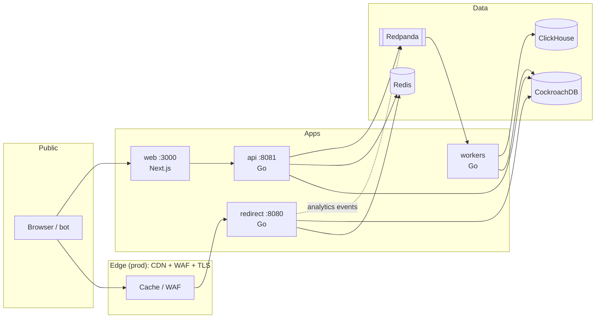

# Linkspire — Privacy-First URL Shortener Platform

**Linkspire** is a full-stack link platform: shorten URLs, serve redirects at scale, manage workspaces from a dashboard, and collect **privacy-safe analytics** (no raw IP storage, no cross-day visitor tracking).

Design targets (production intent): **~100M redirects/day**, **50k req/s** burst, redirect **p99 &lt; 30 ms** at origin, **99.99%** redirect availability, **RPO = 0** for committed link rows.

---

## How the system works

Two paths share one database but have **different latency budgets**:

| Path | Who | Goal |
|------|-----|------|
| **Redirect (hot)** | Anyone clicking a short link | Resolve code → HTTP redirect in milliseconds; never block on third parties |
| **Control plane (warm)** | Dashboard users & API clients | Create links, domains, keys, webhooks; scan URLs; run compliance jobs |



### 1. Clicking a short link (redirect service)

1. Request hits **redirect** (`services/redirect`) with a short code (e.g. `GET /aB3xY7z`).
2. **L1 in-process cache** → on miss, **Redis** → on miss, **CockroachDB** (read path).
3. **Singleflight** collapses stampedes on the same cold key.
4. Optional **Bloom filter** (when pre-populated) rejects unknown codes without hitting DB.
5. Response: **302/301** (or password interstitial, 410 gone, 503 if DB unavailable).
6. **Analytics**: a click event is published to **Redpanda** asynchronously. If the broker is down, analytics may drop; **redirects still succeed**.

**Rule:** no synchronous call to external scanners, geo APIs, or ClickHouse on this path.

### 2. Creating and managing links (management API + dashboard)

1. **Web** (`web/`) is the Next.js 15 dashboard and marketing site. It calls the API with a **session cookie** or you use **API keys** directly.
2. **API** (`services/api/`) handles auth (JWT, Argon2id passwords, TOTP, API keys), RBAC, links, custom domains, QR, webhooks, DSAR, etc.
3. New destinations are **queued for scanning** before (or as) they are stored; malicious URLs must not get a durable row.
4. **Workers** (`services/workers/`) consume Kafka/Redpanda topics: malware scanner, SSRF-hardened scraper, domain verifier, QR generation, retention, DSAR erasure.

### 3. Short codes (not guessable sequential IDs)

- Internal numeric IDs come from a **HiLo allocator** in the database.
- Public codes are **7-character Base62** values from a **keyed Feistel permutation** over a fixed range ([`pkg/codec`](pkg/codec)) — bijective, non-sequential, shared between API and redirect.

### 4. Privacy-preserving analytics

- Geo, device, browser, referrer are derived **in memory** on the redirect path; **IPs are not written** to analytics storage.
- **Daily unique** visitors use a **salt that rotates and is destroyed** (no cross-day tracking).
- Raw events land in **ClickHouse** with TTLs; aggregates roll up and age out (see `db/clickhouse/` and [`docs/architecture/05-data-layer.md`](docs/architecture/05-data-layer.md)).

---

## What we use, why, and where

| Technology | Used for | Why this choice |
|------------|----------|-----------------|
| **Go 1.22+** | `services/redirect`, `services/api`, `services/workers`, `pkg/*` | Single language on the backend: predictable latency for redirect, strong concurrency, small distroless images |
| **Next.js 15 (App Router)** | `web/` | Server components + server actions for dashboard; standalone Docker output; marketing pages at `/`, `/features`, `/privacy`, etc. |
| **CockroachDB** | System of record (`db/migrations/`) | Distributed SQL, multi-region story, serializable transactions, survives regional loss with RF=3 (prod); Postgres-compatible wire protocol |
| **Redis** | L2 cache, rate limits, session adjacency | Sub-ms reads for hot codes; optional RedisBloom in prod for negative cache |
| **Redpanda (Kafka API)** | Click events, async jobs | Durable buffer between hot path and workers; backpressure without blocking redirects |
| **ClickHouse** | Analytics store | Columnar rollups, TTLs, high ingest for click streams |
| **Docker Compose** | `deploy/docker/compose.yaml` | One-command local stack: CRDB, Redis, Redpanda, ClickHouse, migrate, redirect, api, workers, web |
| **Helm / Terraform** | `deploy/helm`, `deploy/terraform` | Production-shaped deploy (HPA, PDBs, cloud modules) — Phase 6 |
| **Plus Jakarta Sans + JetBrains Mono** | Typography (`web/src/lib/fonts.ts`) | Readable UI type + clear code/URL display via `next/font` (self-hosted at build) |

### Shared Go packages (`pkg/`)

| Package | Purpose |
|---------|---------|
| `codec` | Base62 + Feistel code generation |
| `ssrfguard` | Block internal/metadata URLs in scraper workers |
| `argon2id` | Password hashing |
| `slug`, `urlpolicy`, `scan`, `problem`, `idgen` | Validation, errors (RFC 7807), IDs |

---

## Repository layout

```text
linkspire/
├── services/redirect/     # Hot-path redirects (L1 → Redis → PG)
├── services/api/          # REST /v1, auth, RBAC, OpenAPI
├── services/workers/        # Scanner, scraper, verifier, QR, retention, DSAR
├── web/                     # Dashboard + marketing site
├── pkg/                     # Shared Go libraries
├── db/migrations/           # CockroachDB DDL (golang-migrate)
├── db/clickhouse/           # Analytics DDL + TTLs
├── deploy/docker/           # Local & CI images (distroless Node/Go)
├── deploy/helm/             # Kubernetes charts
├── deploy/terraform/        # Cloud infra
├── docs/architecture/       # Capacity, flows, ADRs, STRIDE, per-service docs
├── docs/compliance/         # RoPA, DPA, privacy policy templates
└── docs/runbooks/           # Incident and ops runbooks
```

---

## Run locally (Docker)

From the repo root:

```powershell
docker compose -f deploy/docker/compose.yaml up --build -d
```

| Service | URL |
|---------|-----|
| Dashboard & marketing | http://localhost:3000 |
| Management API | http://localhost:8081 |
| Redirect (short links) | http://localhost:8080/{code} |
| CockroachDB UI | http://localhost:8090 |

After UI changes, rebuild the web image:

```powershell
docker compose -f deploy/docker/compose.yaml build web
docker compose -f deploy/docker/compose.yaml up -d --no-deps --force-recreate web
```

For fast frontend iteration: `cd web && npm run dev` (stop the `web` container if port 3000 conflicts).

**Dev secrets** in Compose are placeholders (`TOKEN_SIGNING_KEY`, `FEISTEL_KEY`, etc.) — override for any shared environment.

---

## Core principles

1. **No synchronous third-party network call on the redirect hot path.**
2. **Never persist raw IPs, full user agents, or plaintext passwords** for analytics.
3. **Privacy wins ties** — document tradeoffs when accuracy conflicts with minimization.
4. **Boring, proven tech** unless a measured SLO requires otherwise.

---

## Documentation map (deep dives)

| Topic | Document |
|-------|----------|
| Capacity & sizing | [`docs/architecture/01-capacity-estimation.md`](docs/architecture/01-capacity-estimation.md) |
| Flows & degradation | [`docs/architecture/02-architecture-and-flows.md`](docs/architecture/02-architecture-and-flows.md) |
| ADRs (language, DB, codes, 302 default, ClickHouse, TLS) | [`docs/architecture/03-adr.md`](docs/architecture/03-adr.md) |
| STRIDE threat model | [`docs/architecture/04-threat-model.md`](docs/architecture/04-threat-model.md) |
| Data layer | [`docs/architecture/05-data-layer.md`](docs/architecture/05-data-layer.md) |
| Redirect service | [`docs/architecture/06-redirect-service.md`](docs/architecture/06-redirect-service.md) |
| Management API | [`docs/architecture/07-management-api.md`](docs/architecture/07-management-api.md) |
| Dashboard | [`docs/architecture/08-dashboard.md`](docs/architecture/08-dashboard.md) |
| Infra & CI | [`docs/architecture/09-infrastructure.md`](docs/architecture/09-infrastructure.md) |
| API contract | [`services/api/openapi.yaml`](services/api/openapi.yaml) |

---

## License & name

**Linkspire** is a working product name. Compliance templates under `docs/compliance/` are starting points, not legal advice.
