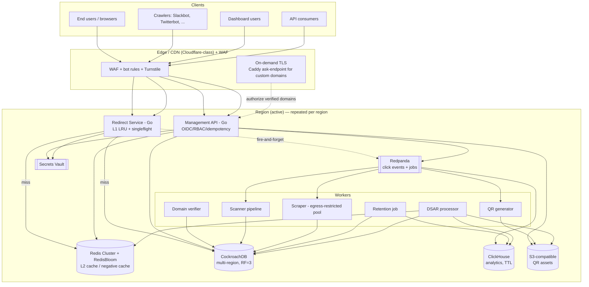
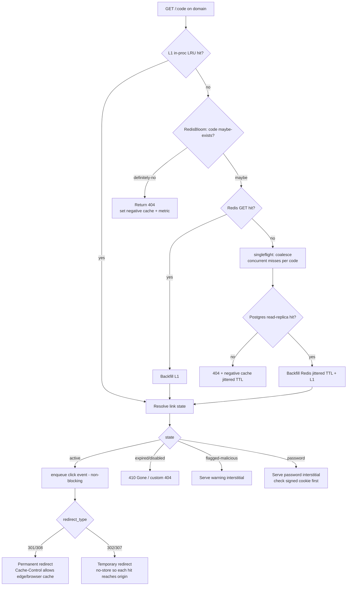
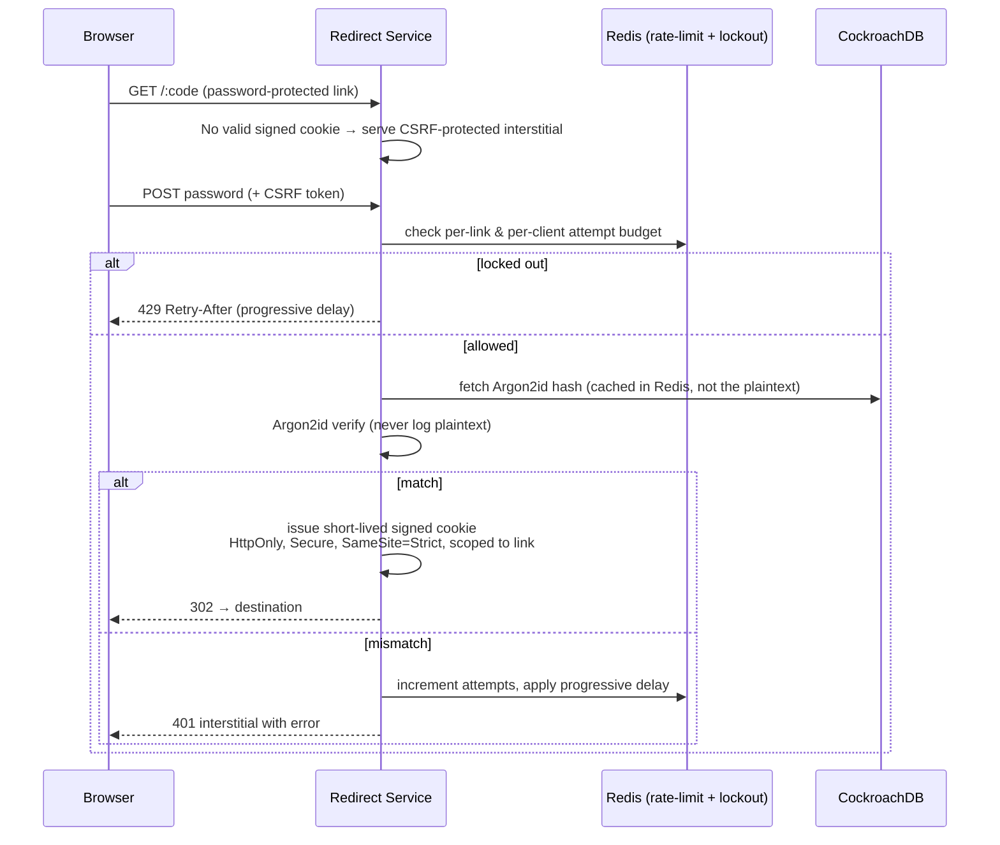
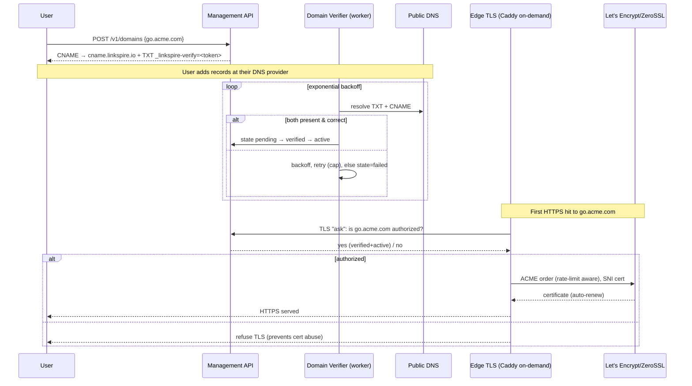
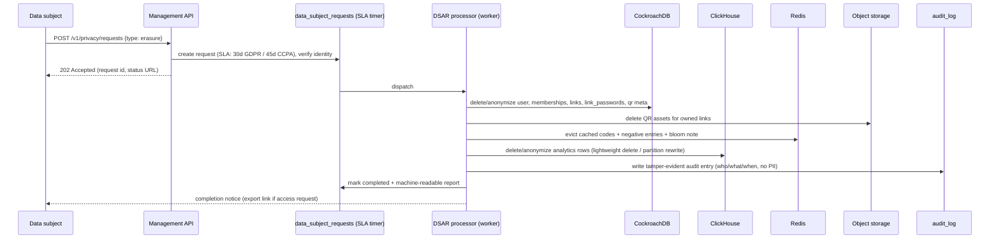

<!-- docs/architecture/02-architecture-and-flows.md -->
# Phase 1.2 — High-Level Architecture & Request Flows

## 1. System context (high level)



**Tiering principles**

- **Hot path = Redirect Service only.** It talks to L1 (in-proc), Redis, and a Postgres read replica. It
  **never** makes a synchronous third-party call. Click events are fire-and-forget to Redpanda with a
  bounded local buffer and backpressure (drop analytics, never redirects).
- **Everything expensive is async:** scanning, scraping, QR, metadata, analytics rollups — all consume
  from Redpanda.
- **Each region is a full active stack.** CockroachDB spans regions for global code uniqueness and RPO=0;
  Redis/ClickHouse/Redpanda are per-region. Edge steers users to the nearest healthy region.

## 2. Redirect hot path



**Hot-path guarantees**

- Lookup order **L1 → Bloom → Redis → Postgres replica → backfill both caches** (§ matches brief).
- **Stampede protection:** `singleflight` coalesces concurrent misses for the same code into one DB read;
  all cache TTLs are jittered to avoid synchronized expiry.
- **Negative caching + Bloom** absorb enumeration attacks before they reach Redis/Postgres.
- **Click emission is non-blocking:** bounded ring buffer → async producer. If Redpanda is unavailable the
  buffer drains to a local WAL then drops oldest; **the redirect is issued regardless.**
- **Status default = 302** (analytics-friendly); 301/307/308 configurable per link (see ADR-004).

## 3. Link creation

```mermaid
sequenceDiagram
    participant Cli as Client (API/UI)
    participant API as Management API (Go)
    participant Scan as Fast sync check (<20ms)
    participant PG as CockroachDB
    participant K as Redpanda
    participant W as Async workers

    Cli->>API: POST /v1/links (Idempotency-Key, dest, opts)
    API->>API: AuthN (OIDC/API key), RBAC, rate-limit budget
    API->>API: Validate URL; reject data:/javascript:; normalize
    API->>Scan: local Safe-Browsing hash DB + heuristics (<20ms)
    alt immediately malicious
        API-->>Cli: 422 rejected (problem+json)
    else clean/suspicious-pending
        API->>PG: INSERT link (code via Feistel; unique(domain_id,code))
        Note over PG: Global unique index → no cross-region dup codes (RPO=0)
        PG-->>API: committed
        API->>K: publish link.created
        API-->>Cli: 201 Created (short URL, QR pending)
        K->>W: deep scan, QR gen, metadata scrape (async)
        W->>PG: update scan_verdict / qr_codes / link_metadata
        W->>K: webhook link.created / link.flagged (if verdict flips)
    end
```

- Code is generated by a keyed Feistel permutation over the Base62 space (ADR-003) — no DB round-trip to
  pick an ID, non-enumerable by construction.
- **Creation never waits on slow scanners.** A sub-20 ms local check gates obvious abuse; deep scanning is
  async and flips state + fires `link.flagged` + notifies owner if needed.
- **Idempotency-Key** makes retries safe (dedup table keyed by `(workspace, key)`).

## 4. Password unlock



- Password-protected links are **excluded from metadata previews** (no OG/destination leakage to crawlers).
- Cookie is scoped to the single link; verification is Argon2id with documented, tuned parameters.

## 5. Custom-domain onboarding (CNAME + on-demand TLS)



- Apex domains: ALIAS/ANAME where the provider supports it; A-record fallback documented as a limitation.
- Per-domain settings: root-path default redirect, custom 404, HSTS toggle.
- The **ask endpoint only authorizes verified+active domains**, bounding ACME issuance and abuse.

## 6. DSAR erasure (right to be forgotten)



- Erasure **cascades across every store**: Postgres, caches (L1 handled via TTL + explicit bust), object
  storage, analytics, and search/index if present.
- The `audit_log` records the action **without** storing the erased PII.

## 7. Degradation matrix

| Failure | Behavior | Guarantee |
|---------|----------|-----------|
| **Redis down** | Serve from L1; misses go straight to Postgres read replicas; tighten rate limits; disable negative-cache writes | Redirects keep flowing (higher p99); writes unaffected |
| **Kafka/Redpanda down** | Click events buffer in bounded local ring → local WAL; drop oldest when full | **Redirects never blocked**; analytics lossy during outage (documented) |
| **Postgres replica down** | Route reads to another replica; fall back to primary with circuit breaker | Reads continue; writes unaffected |
| **Postgres primary/region down** | Automated CockroachDB region failover; standby promoted | RTO < 5 min; RPO = 0 (consensus-committed) |
| **Scanner feed down** | Fast local DB still applies; deep scan queued; fail safe = suspicious until verified for risky links | Creation not blocked |
| **Scraper egress down** | Preview falls back to user overrides or no card | Redirect unaffected |
| **ACME/cert outage** | Serve existing (unexpired) certs; queue issuance; alert | Existing custom domains keep working |
| **Edge/CDN region down** | Anycast/health-checked DNS steers to next region | 99.99% budget preserved |

## 8. SLOs & error budgets (redirect path)

| SLI | Target | Window |
|-----|--------|--------|
| Redirect availability (non-5xx / total) | 99.99% | 30-day rolling |
| Redirect latency (origin, cache hit) | p99 < 5 ms | 5-min + 1-h |
| Redirect latency (origin, overall) | p50 < 10 ms, p99 < 30 ms | 5-min + 1-h |
| Click-event delivery (best-effort) | ≥ 99.5% delivered | 1-day |

- **Multi-window, multi-burn-rate alerts** (e.g. fast: 2%/1h at 14.4x burn; slow: 5%/6h) on the
  availability and latency SLIs, wired to OpenTelemetry → Prometheus → Alertmanager.
- Error budget policy: when budget is exhausted, freeze risky deploys to the redirect path until recovered.

## Assumptions and Open Questions

- **Assumptions:** Cloudflare-class edge provides WAF + Turnstile + anycast; CockroachDB multi-region is the
  authority for global code uniqueness; each region runs independent Redis/ClickHouse/Redpanda; the edge can
  perform on-demand TLS with an ask endpoint (Caddy or equivalent at the edge/ingress).
- **Open questions:** (1) Is edge caching of 301/308 acceptable to product given it suppresses per-hit
  analytics for those links? (2) For CCPA erasure of analytics, is anonymization (drop join keys) acceptable
  vs hard delete, to preserve aggregate counts? (3) Do we need active-active *writes* per region, or
  active-passive with a single write home region per tenant (residency)?
